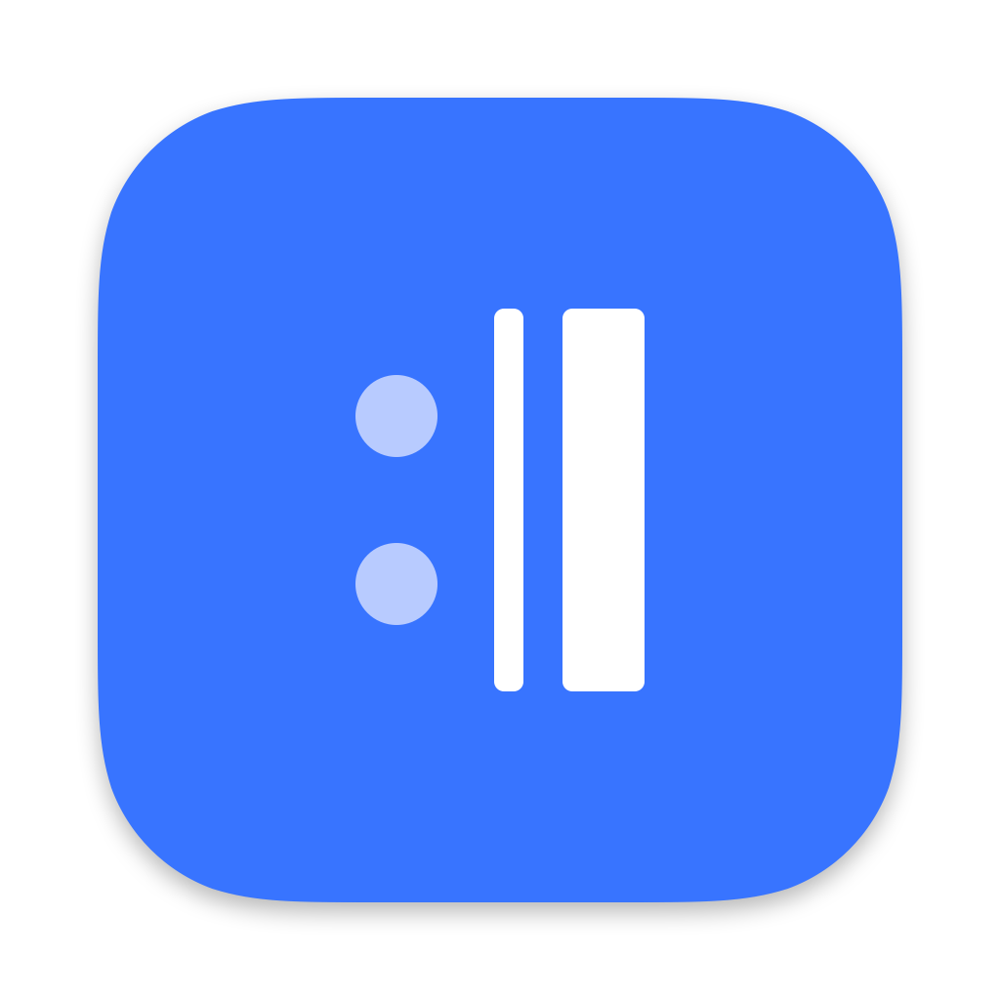

<p align="center"></p>

# Encore

Now Playing on the Mac lock screen, before you sign in.

- **A small player** on Apple’s Liquid Glass, with the blur off so it’s clear like the Dock: the cover, the song, where you are in it, and play, pause and skip.
- **Full screen**: click the cover and it grows and moves into place over a wash of its own colours, with the song and controls on a glass panel under it. “Show less” goes back. Touch ID and typing your password still unlock the Mac from here.
- **Time-synced lyrics**: the mic on the full-screen panel opens them beside the cover, with a small dot under the mic while they’re open. They scroll the way Apple Music’s do: the current line bright, the rest dimmer and softer, word by word for songs that have word timing. Click a line to jump to it.
- **A clock that matches yours**: the full-screen view covers the lock screen’s clock, so it draws one in the same font and weight you’ve chosen in System Settings, and follows it when you change it.

It works with anything macOS knows is playing: Spotify, Music, a browser tab.

## Install

1. Download **Encore.dmg** from the [latest release](../../releases/latest), open it and drag **Encore** onto the Applications folder.
2. Open Encore from Applications. macOS will say it can’t check the app, because Encore isn’t notarised by Apple (that needs a paid Apple developer account). Click **Done**.
3. Open **System Settings → Privacy & Security**, scroll down to the message about Encore, click **Open Anyway** and confirm. You only do this once.
4. Encore appears as a music note in the menu bar and turns on **Open at login**, so it’s there every time you start your Mac. Play a song and lock your Mac with ⌃⌘Q.

If you’re comfortable in Terminal, this does steps 2 and 3 in one go:

```bash
xattr -dr com.apple.quarantine /Applications/Encore.app
```

**Needs:** macOS 14 or later. The clear glass needs macOS 26 or later; older versions get a plain blurred panel. Built and tested on macOS 27.2 on Apple silicon. The Intel build is included but untested.

## The menu

From the music note in the menu bar you can:

- turn the lock screen player on or off
- have the cover open full screen by itself every time you lock
- turn lyrics on or off
- preview the player on the desktop, including full screen, without locking
- turn Open at login off or back on (it’s on after the first launch from Applications)

## Build it yourself

You need Xcode.

```bash
./scripts/build.sh
```

```bash
open build/Encore.app
```

`./scripts/package.sh` builds the app and packages it for sharing as a zip and a disk image. `swift scripts/make-icon.swift` redraws the icon.

`./scripts/record-demo.sh` records a short demo with whatever song is playing. Encore covers the screen with a stand-in lock screen and runs itself through the card, full screen and lyrics, and the script writes a video and a GIF to `media/`. It needs ffmpeg.

## How it works

Three parts of macOS that Apple doesn’t document make this possible.

- **Reading what’s playing.** macOS only gives Now Playing details to Apple’s own programs. `Helper/bridge.m` is a small library that gets loaded into the system’s Perl (`/usr/bin/perl`), which is allowed to read them. It prints a line of JSON whenever the song changes and takes play, pause, skip and seek commands back. `Sources/Encore/NowPlaying.swift` runs it and keeps the app’s copy of the song up to date.
- **Drawing on the lock screen.** macOS hides every app’s windows while locked. `Sources/Encore/SkyLight.swift` asks the window server to put Encore’s window on the layer the system uses for lock screen notifications.
- **Clear glass.** The glass is Apple’s own `NSGlassEffectView`. Used by an app it always blurs what’s behind the window. `ClearGlassView` in `PlayerCard.swift` sets the one number inside it that controls that blur to zero, and puts it back to zero whenever the system rewrites it.

The rest is ordinary SwiftUI:

- `PlayerCard.swift` is the small card and `PlayerScene.swift` is the full-screen view. Both are laid out in whole-screen coordinates, and there is one cover for the whole player: each layout leaves an empty slot for it, and it sits in whichever is live. That is why expanding is one image growing and travelling, not two fading across.
- `PlayerWindowController.swift` owns the window. The window is a porthole onto that scene: only as big as the card, so clicks around it still reach the lock screen, and the size of the screen once the cover is expanded.
- `Lyrics.swift` gets lyrics from [LRCLIB](https://lrclib.net), a free, open lyrics database. It sends the song’s title, artist, album and length, and nothing else.
- `LockClock.swift` reads the lock screen clock’s font and weight from macOS’s settings.

## Good to know

- Because these tricks are undocumented, a macOS update can break them. Encore checks for each one and falls back: no lock screen player, or Apple’s default blurred glass.
- The full-screen view covers the lock screen’s own clock and draws its own. The lock screen draws its clock and wallpaper in a single solid window, so no window can go between them, and the lock screen’s wallpaper is a separate setting that apps can’t change.
- Between songs the player holds still. The old cover stays until the new one arrives, the lyrics column keeps its place with soft placeholder lines while lyrics load, and a moment of “nothing playing” from the music app is ignored. If a song has no lyrics, the column says so.
- Lyrics are only looked up once the song’s length is known, because the length is what tells two recordings of the same song apart.
- With Reduce Transparency on in Accessibility settings, the glass keeps Apple’s default blur.
- Lyrics depend on LRCLIB having the song. Many songs have line timing only; word-by-word lighting needs word timing, which fewer songs have.
- This can’t go on the App Store, because of the undocumented parts above.
- `~/Library/Logs/Encore.log` records what happened on the lock screen, since you can’t inspect it while it’s up.

## Thanks

The two ideas Encore stands on were worked out in the open by others: reading Now Playing through the system’s Perl ([mediaremote-adapter](https://github.com/ungive/mediaremote-adapter)) and showing a window over the lock screen through SkyLight ([SkyLightWindow](https://github.com/Lakr233/SkyLightWindow)). Encore’s code is its own, written from those ideas. Lyrics come from [LRCLIB](https://lrclib.net).
